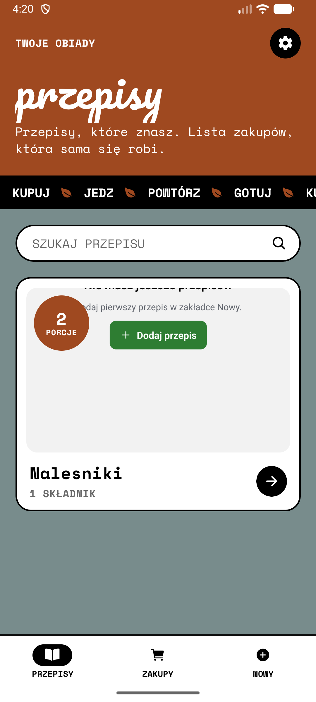
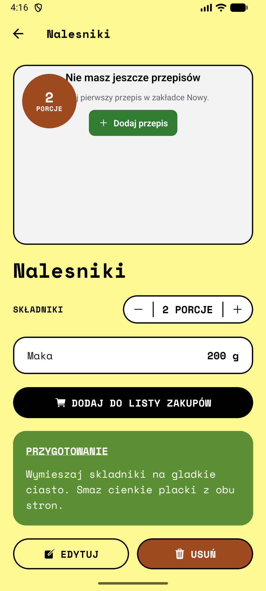
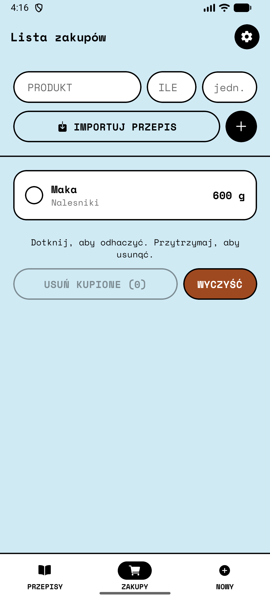
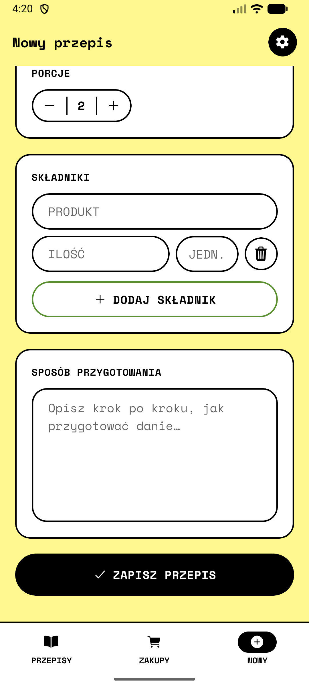

<div align="center">

# 🍳 Przepisy

**Przepisy, które znasz. Lista zakupów, która sama się robi.**

Aplikacja na Androida do zapisywania przepisów obiadowych i układania z nich listy zakupów.
Wszystko działa offline, a dane są trzymane lokalnie na telefonie.


</div>

---

## 📸 Zrzuty ekranu

<p align="center">
  
  
  
  
  
</p>

## ✨ Funkcje

- **Przepisy**: tytuł, zdjęcie (z galerii albo aparatu), liczba porcji, składniki z ilościami i jednostkami, opis przygotowania.
- **Etykiety**: śniadanie, obiad, kolacja, zupa, deser, przekąska, wege.
- **Wyszukiwarka** przepisów na ekranie głównym.
- **Lista zakupów**:
  - produkty dodane ręcznie albo **zaimportowane z przepisu** jednym kliknięciem,
  - te same produkty w tej samej jednostce **sumują się same** (np. 200 g + 400 g mąki → 600 g),
  - dotknięcie odhacza produkt, przytrzymanie go usuwa,
  - przyciski „Usuń kupione” i „Wyczyść”.
- **Polska odmiana** liczebników („1 składnik”, „2 składniki”, „5 składników”).
- **Ustawienia**: miejsce na klucz API DeepSeek, trzymany w bezpiecznym magazynie (`expo-secure-store`).
- Wyrazisty styl **„Touchy Coffee”**: kolorowe pasy tła, pigułkowe kontrolki, grube czarne ramki, fonty Space Mono i Pacifico.

## 🛠️ Technologie

| Obszar | Biblioteka |
| --- | --- |
| Framework | [Expo](https://expo.dev) SDK 58, React Native 0.88, React 19 |
| Nawigacja | `expo-router` (routing oparty na plikach, typowane trasy) |
| Baza danych | `expo-sqlite` z migracjami przez `PRAGMA user_version` |
| Pliki i zdjęcia | `expo-file-system`, `expo-image-picker`, `expo-image` |
| Klawiatura | `react-native-keyboard-controller` |
| Animacje | `react-native-reanimated`, `react-native-worklets` |
| Język | TypeScript, React Compiler |

## 📂 Struktura projektu

```
src/
├── app/                 # ekrany (expo-router)
│   ├── (tabs)/          # zakładki: Przepisy, Zakupy, Nowy
│   ├── recipe/[id].tsx  # szczegóły przepisu
│   ├── recipe/edit/     # edycja przepisu
│   └── settings.tsx     # ustawienia
├── components/          # wspólne klocki UI (Button, Card, PillInput, Stepper...)
├── constants/           # motyw (kolory, fonty, promienie) i nagłówki
├── db/                  # schemat SQLite, przepisy, lista zakupów
└── lib/                 # zdjęcia, etykiety, jednostki i odmiana, ustawienia
```

## 🚀 Uruchomienie

> [!IMPORTANT]
> Aplikacja **nie działa w Expo Go**, bo korzysta z natywnego modułu `react-native-keyboard-controller`. Trzeba zbudować APK albo development build.

### Wymagania

- Node.js (LTS)
- Android Studio z Android SDK i NDK
- JDK 17+

### Instalacja

```bash
git clone https://github.com/rzyrafa/zakupy-app.git
cd zakupy-app
npm install
```

### Uruchomienie na urządzeniu lub emulatorze

```bash
npx expo run:android
```

### Build APK (release)

```bash
npx expo prebuild -p android
cd android
./gradlew assembleRelease
```

Gotowy plik: `android/app/build/outputs/apk/release/app-release.apk`.

Żeby zbudować pod emulator x86_64, dodaj `-PreactNativeArchitectures=x86_64`.

> [!TIP]
> Na Windowsie trzymaj projekt w krótkiej ścieżce (np. `C:\dev\zakupy-app`). Kompilacja C++ bibliotek natywnych potrafi przekroczyć limit 260 znaków.

### Sprawdzanie kodu

```bash
npx tsc --noEmit   # typy
npx expo lint      # ESLint
```

## 🗺️ Plany

- [ ] Generowanie opisu przygotowania przez AI (DeepSeek)

## 📄 Licencja

Projekt na licencji [MIT](LICENSE).
